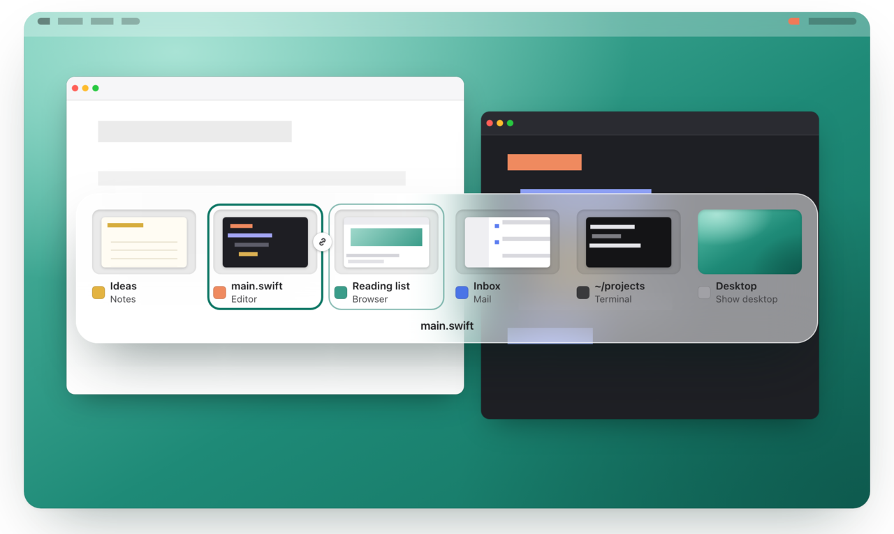

<p align="center">
  
</p>

<h1 align="center">Paneflo</h1>

<p align="center">
  Every window. In its place.<br>
  A window switcher, tiling and an organized Overview in one native macOS menu bar app.
</p>

<p align="center">
  <a href="https://github.com/Jenish-Shobhit/Paneflo/releases/latest"></a>
  <a href="https://github.com/Jenish-Shobhit/Paneflo/actions/workflows/macos.yml"></a>
  <a href="LICENSE"></a>
  
  
  
</p>

<p align="center">
  <a href="https://jenish-shobhit.github.io/Paneflo/"><strong>Download</strong></a> ·
  <a href="docs/user-guide.md">User guide</a> ·
  <a href="docs/shortcuts.md">Shortcuts</a> ·
  <a href="CHANGELOG.md">Changelog</a>
</p>

<picture>
  <source media="(prefers-color-scheme: dark)" srcset="docs/images/switcher-dark.png">
  
</picture>

Hold ⌘ and press Tab to pick a **window**, not an app, with a live preview of the one you're on. Drag windows to the edges of the screen or tile them from the keyboard, and open an Overview that keeps every window in a place you chose.

## Why Paneflo

- **Windows, not apps.** Two browser windows are two cards. Release ⌘ and exactly that window comes forward.
- **A live look at your pick.** Only the selected window plays live; the rest show recent snapshots, kept in memory and never saved.
- **Snap areas and keyboard tiling.** Drag a window to an edge or corner, or press ⌃⌥ with an arrow. Record your own keys for halves, quarters, thirds, Fill, Center and Restore.
- **Tile pairs.** Two windows side by side come forward together, swap in one step and undo in one step.
- **An Overview that stays put.** Slots never reshuffle while it's open. Search, drag to swap, and keep a place for an app that isn't running.
- **Private and native.** Swift, AppKit and Core Animation, no third-party packages, no analytics. Paneflo goes online only to check for and download updates.

## Features

**Switcher**

- ⌘Tab opens a compact glass shelf of window cards; Tab and ⇧Tab step, the arrow keys work too. Release ⌘ to focus, Escape cancels.
- The order follows how you actually switch, and it doesn't change while the switcher is open.
- The selected window's full title sits underneath, and card size adapts so your windows fit on one to three rows.
- With ⌘ held: **W** closes the selected window, **M** minimizes it, **H** hides its app, **Q** quits its app. The switcher stays open.
- A Desktop card shows the desktop by hiding other apps, and brings them back when you pick it again.

**Tiling**

<p align="center">
  
</p>

- **Snap areas.** Drag a window by its title bar to the top edge to fill the display, a side edge for that half, or a corner for a quarter. An outline shows where it will land. The bottom edge does nothing, so dragging past the Dock never resizes a window. Drag a tiled window away and it gets its old size back.
- **Anywhere.** ⌃⌥ with the arrows tiles the front window to a half, ⌃⌥Return fills the display and ⌃⌥Z restores it.
- **Your own keys.** Settings › Tiling › Keyboard Shortcuts has a recorder for every arrangement: halves, quarters, thirds, Fill, Center and Restore. A key another action already uses moves instead of doubling up.
- **In the switcher.** ⌘⌥ with the arrows tiles the selected window. Repeating a half moves it to the next display.
- Tiling restores a minimized window and unhides a hidden app first, and says why in a short note when it can't.

**Tile pairs**

- Two windows filling complementary halves of one display form a pair, whether Paneflo arranged them or you did.
- Opening either one brings its partner forward. ⌘⌥Return opens the pair; ⌘A in the switcher (⌥Return in the Overview) opens just the selection.
- Tile a third window into a paired half and it pairs with the other half. One undo restores every window an arrangement moved.

**Overview**

- ⌃⌥Space shows every window in stable slots on a translucent overlay, with search and a window count.
- Arrow keys move around the grid the way it looks. Drag a window onto a free slot to move it or onto another window to swap. Pinned slots wait for their app.
- Optional, experimental three-finger swipe up to open and down to close.
- The Overview is Paneflo's own overlay. It doesn't change Mission Control or Spaces.

**The app**

- Menu bar only: Tile Front Window, Pause Shortcuts, Settings, Check for Updates and Hide from Menu Bar.
- A short setup guide that opens only while a required permission is missing.
- Light and dark mode, VoiceOver labels, keyboard navigation, Increase Contrast, Reduce Transparency and Reduce Motion.

## Install

**Quickest:** paste this into Terminal and press Return:

```sh
curl -fsSL https://jenish-shobhit.github.io/Paneflo/install.sh | bash
```

It downloads the latest release from GitHub, checks the zip's size and SHA-256 against what GitHub lists, checks that the app is Paneflo at that version and signed with Paneflo's certificate, then moves any older copy to the Trash, puts the new one in `/Applications` and opens it. If a check fails, nothing is installed. A file curl downloads isn't quarantined, so there's no Open Anyway step; the script's checks take its place. If Paneflo is running, it asks you to quit it from the menu bar icon first. Run it again to update. [Read the script](docs/install.sh) before you run it.

**Or download the zip:**

1. Download `Paneflo-<version>.zip` from [Paneflo's website](https://jenish-shobhit.github.io/Paneflo/) or the [latest release](https://github.com/Jenish-Shobhit/Paneflo/releases/latest).
2. Unzip it and move **Paneflo.app** to `/Applications`. Keep it there: macOS ties the permissions to that copy.
3. Open Paneflo. It isn't notarized yet, so macOS blocks the first launch:
   1. In the "Paneflo" Not Opened dialog, click **Done** (not Move to Trash).
   2. Open **System Settings › Privacy & Security** and scroll down to **Security**.
   3. Next to "Paneflo" was blocked…, click **Open Anyway**, then confirm with your password or Touch ID.

You only do this once per download. If it still won't open, see [Troubleshooting](docs/troubleshooting.md#paneflo-cant-be-opened).

**Updating:** choose **Check for Updates…** from the menu bar icon. Paneflo also checks once a day (never while the switcher or Overview is showing). A download replaces the app only after its size, SHA-256, bundle ID, version and signing certificate match the copy you have, so your permissions carry over and there's no Open Anyway next time.

**Requirements:** macOS 26 or later on Apple silicon. Intel Macs aren't supported.

## Permissions

**Set up Paneflo** opens by itself while something it needs is missing. Click **Grant…** on a row, switch Paneflo on in the System Settings pane that opens, and come back; the row turns green on its own. Then hold ⌘ and press Tab.

| Permission | Required | Why |
|---|---|---|
| Accessibility | Yes | Find, focus, move and resize other apps' windows |
| Input Monitoring | Yes | Hear ⌘Tab, the tiling shortcuts and the trackpad gesture |
| Screen Recording | No | Window pictures in the switcher and Overview. Without it, cards show app icons |

Paneflo asks for nothing else. If a row says **Restart Paneflo to apply**, click **Restart Paneflo**; macOS often applies Input Monitoring and Screen Recording only after a relaunch. Still stuck? Use **Permissions stuck? Reset and grant again** ([troubleshooting](docs/troubleshooting.md#permissions-are-on-but-nothing-happens)).

## Shortcuts

The tiling shortcuts can be changed in Settings › Tiling. Everything is listed, and searchable, in Settings › Shortcuts & Help; the full reference is [docs/shortcuts.md](docs/shortcuts.md).

**Switcher** (hold ⌘)

| Keys | Action |
|---|---|
| ⌘Tab · ⌘⇧Tab | Open and step forward · step back. Release ⌘ to focus |
| ← → ↑ ↓ | Choose; ↑ ↓ move by row |
| Esc | Cancel |
| ⌘W · ⌘M · ⌘H · ⌘Q | Close, minimize, hide app, quit app (the selected window) |
| ⌘⌥← · ⌘⌥→ · ⌘⌥↑ · ⌘⌥↓ | Left half, right half, fill, undo for the selected window |
| ⌘⌥Return · ⌘A | Open with its tile partner · open alone |

**Anywhere** (defaults)

| Keys | Action |
|---|---|
| ⌃⌥← · ⌃⌥→ · ⌃⌥↑ · ⌃⌥↓ | Tile the front window to the left, right, top or bottom half |
| ⌃⌥Return | Fill the display |
| ⌃⌥Z | Restore (undo the last arrangement) |
| ⌃⌥Space | Open the Overview |
| Drag to an edge or corner | Fill, half or quarter |

**Overview**

| Keys | Action |
|---|---|
| Arrows · type | Move · search (slots stay in place) |
| Return · ⌥Return | Focus with the tile partner · without it |
| Esc, or click the background | Close |
| Three fingers up · down | Open · close (optional) |

## Settings

Open **Settings…** (⌘,) from the menu bar icon.

| Pane | What's there |
|---|---|
| General | Use Paneflo shortcuts, Launch at login (off by default), Card size, Show selected window title, Show menu bar icon |
| Shortcuts & Help | Every key and gesture, grouped and searchable |
| Tiling | Snap windows by dragging to screen edges, Raise tile pairs together, Show pairs side by side, Snap assist, Keyboard Shortcuts |
| Overview & Gesture | Keep empty places for closed windows, Remove Free Slots, Reset Slot Order…, the three-finger gesture |
| Previews | Window previews and Screen Recording status |
| Desktop | The Desktop card, and the experimental Use macOS Show Desktop |
| Permissions | Live status, Restart Paneflo, Permissions stuck? Reset and grant again…, Open Setup Guide… |
| Updates | Check for updates automatically, Check Now |

## Privacy

Paneflo works entirely on your Mac. It has no analytics, no telemetry and no accounts. It goes online only to ask GitHub for the latest release and to download an update, and it sends nothing about you. Turn off the daily check in Settings › Updates and Paneflo goes online only when you choose **Check for Updates…**.

- Window snapshots stay in memory, are never written to disk, and are cleared when you lock the screen, switch users or turn previews off.
- Settings and the Overview's slot order are stored in the preferences domain `dev.paneflo.Paneflo`.
- The updater writes a log to `~/Library/Logs/Paneflo/Update.log`. [SECURITY.md](SECURITY.md) lists what Paneflo accesses.

## Uninstall

1. Quit Paneflo from its menu bar icon (**Quit Paneflo**). If you turned on Launch at login, turn it off in Settings › General first.
2. Delete `/Applications/Paneflo.app`.
3. Remove its settings and log:

   ```sh
   defaults delete dev.paneflo.Paneflo
   rm -rf ~/Library/Logs/Paneflo
   ```

4. Optional: clear its privacy permissions with `tccutil reset All dev.paneflo.Paneflo`.

## Building from source

You need Swift 6.2 or later with the macOS SDK (the Xcode Command Line Tools are enough). There are no third-party packages.

```sh
git clone https://github.com/Jenish-Shobhit/Paneflo.git
cd Paneflo
./scripts/make-signing-identity.sh   # once: a self-signed "Paneflo Dev" certificate
./scripts/build.sh --install --run   # build, sign, replace /Applications/Paneflo.app and open it
./scripts/test.sh                    # run the test suites
```

Without the "Paneflo Dev" certificate the app is signed ad hoc, and macOS asks for permissions again after every rebuild. [docs/building.md](docs/building.md) covers signing, tests, benchmarks and releases.

## Documentation

- [User guide](docs/user-guide.md): every feature and setting.
- [Keyboard shortcuts](docs/shortcuts.md): the complete reference.
- [Troubleshooting](docs/troubleshooting.md): opening, permissions, shortcuts, the gesture, previews and updates.
- [Architecture](docs/architecture.md): modules, threads and performance invariants.
- [Building](docs/building.md): build, test, sign, release and benchmarks.
- [Manual QA](docs/QA.md): the checks run before each release.
- [Status](docs/status.md): verification record and known limits.
- [Specifications](docs/specs/000-product.md): product and [engineering](docs/specs/001-engineering.md) specs.

## Contributing

Bug reports, ideas and focused pull requests are welcome. Read [CONTRIBUTING.md](CONTRIBUTING.md) first and follow the [Code of Conduct](CODE_OF_CONDUCT.md). Report security issues privately as described in [SECURITY.md](SECURITY.md). For questions, see [SUPPORT.md](.github/SUPPORT.md).

## License

[MIT](LICENSE) © 2026 Jenish Shobhit

## Acknowledgements

Paneflo is built with Swift, AppKit, Core Animation, SwiftUI, the Accessibility API and ScreenCaptureKit, and has no third-party dependencies.
