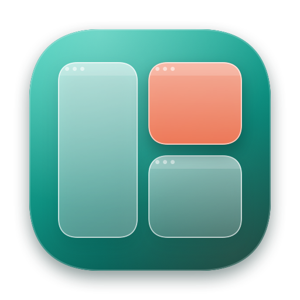

<p align="center">
  
</p>

<h1 align="center">Paneflo</h1>

<p align="center"><strong>Every window. In its place.</strong></p>

<p align="center">
  <a href="https://github.com/Jenish-Shobhit/Paneflo/actions/workflows/macos.yml"></a>
  <a href="https://github.com/Jenish-Shobhit/Paneflo/releases/latest"></a>
  <a href="https://github.com/Jenish-Shobhit/Paneflo/releases"></a>
  <a href="LICENSE"></a>
  
</p>

<h3 align="center">
  <a href="https://jenish-shobhit.github.io/Paneflo/">Download Paneflo</a> ·
  <a href="https://github.com/Jenish-Shobhit/Paneflo/releases/latest">Latest release</a> ·
  <a href="docs/user-guide.md">User guide</a>
</h3>

Paneflo is a native macOS menu-bar app for finding, arranging and switching between individual windows. Three modules share one list of your windows: a Command-Tab that lists **windows** instead of apps, keyboard **tiling**, and an organized **Overview** that keeps windows in slots you control. The Overview is Paneflo's own panel; it does not modify Apple's Mission Control or control native Spaces.

Free and open source under the [MIT License](LICENSE). Requires macOS 26 or later on Apple silicon. Current state and known limits: [docs/status.md](docs/status.md).

## Features

- **Window switcher.** Hold ⌘ and press Tab to pick one window, not an app. Shift-Tab goes back, arrows also choose, release ⌘ to focus, Escape cancels. A compact glass shelf of cards with the selected window's full title underneath.
- **Previews.** Optional cached snapshots, plus one live preview for the selected window only. Minimized, hidden, other-Space and paused previews are marked honestly.
- **Window actions while switching.** With ⌘ held: W closes, M minimizes, H hides the app, Q quits it. The picker stays open.
- **Tiling anywhere.** ⌃⌥ with the arrows tiles the frontmost window into halves, ⌃⌥Return fills the display, ⌃⌥Z undoes. In the picker, ⌘⌥ with the arrows tiles the selected window.
- **Tile pairs.** Two windows in complementary halves of one display form a pair: shown side by side in the switcher, raised together, replaced in one step, restored with one undo.
- **Organized Overview.** ⌃⌥Space shows every window in stable slots on a translucent overlay. Search, move spatially with the arrows, drag to swap, pin slots for apps that are not open.
- **Trackpad gesture (optional, experimental).** Three-finger swipe up opens the Overview, down closes it.
- **Desktop entry.** A Desktop card in the switcher and a Desktop tile in the Overview reveal the desktop by hiding other apps.
- **Menu-bar app.** Tile Front Window, Pause Shortcuts, Settings, Check for Updates, and Hide from Menu Bar.
- **Accessible and considerate.** VoiceOver labels, keyboard-navigable setup, and Increase Contrast, Reduce Transparency and Reduce Motion are respected.
- **Private.** No analytics or telemetry; the only network use is the update check. See [Privacy](#privacy).

## Keyboard shortcuts

| Where | Keys | Action |
| --- | --- | --- |
| Switcher | ⌘Tab / ⌘⇧Tab | Open, step forward / back (release ⌘ to focus) |
| Switcher | Arrows (⌘ held) | Choose; Up/Down move by row |
| Switcher | Esc | Cancel |
| Switcher | ⌘W · ⌘M · ⌘H · ⌘Q | Close, minimize, hide app, quit app (selected window) |
| Switcher | ⌘A | Open the selection without its tile partner |
| Switcher | ⌘⌥ ← → ↑ ↓ | Left half, right half, fill, undo for the selected window |
| Switcher / Overview | ⌘⌥Return | Open the selection with its tile partner |
| Anywhere | ⌃⌥ ← → ↑ ↓ | Tile the frontmost window: left, right, top, bottom half |
| Anywhere | ⌃⌥Return · ⌃⌥Z | Fill the display · undo the last arrangement |
| Anywhere | ⌃⌥Space | Open the Overview |
| Overview | Arrows, Return, Esc | Move, focus, close (⌥Return focuses without the partner) |
| Trackpad | Three fingers up / down | Open / close the Overview (optional) |
| Menu bar | ⌘, | Settings |

The complete, grouped list is in [docs/shortcuts.md](docs/shortcuts.md) and in Settings › Shortcuts & Help.

## Install

1. Download `Paneflo-<version>.zip` from the [download page](https://jenish-shobhit.github.io/Paneflo/) or [GitHub Releases](https://github.com/Jenish-Shobhit/Paneflo/releases/latest), unzip it, and move **Paneflo.app** to `/Applications`.
2. Paneflo is not notarized yet. On first open, go to **System Settings › Privacy & Security** and choose **Open Anyway**.
3. **Set up Paneflo** opens by itself while something it needs is missing. For each row, click **Grant…**, switch Paneflo on in the System Settings pane that opens, and come back; the row turns green on its own. Hold ⌘ and press Tab to try it.
4. If a row says **Restart Paneflo to apply**, click **Restart Paneflo**; macOS often applies Input Monitoring and Screen Recording only after a relaunch.
5. Permissions still off after a restart? Use **Permissions stuck? Reset and grant again**; see [Troubleshooting](docs/troubleshooting.md).

### Permissions

| Permission | Required | Why |
| --- | --- | --- |
| Accessibility | Yes | Find, focus, move and resize other apps' windows. |
| Input Monitoring | Yes | Hear ⌘Tab, the tiling shortcuts and the trackpad gesture. |
| Screen Recording | No | Window pictures in the switcher and Overview. Without it, cards show app icons. |

Paneflo requests nothing else.

## Updates

Choose **Check for Updates…** in the menu-bar menu. Paneflo also checks once a day unless you turn it off in Settings › Updates, and never while the switcher or Overview is showing. A download is verified (size, SHA-256, bundle ID, version, code signature, and the same signing certificate as the running copy) before it replaces the app, so permissions carry over.

## Privacy

Paneflo's only network use is the update check and download from GitHub. There is no analytics or telemetry. Snapshots stay in memory and are never written to disk or sent anywhere. Slot order and settings are stored locally on your Mac.

## Building from source

Requires Swift 6.2 or newer with the macOS SDK. No third-party packages.

```sh
./scripts/make-signing-identity.sh   # once: creates the self-signed "Paneflo Dev" certificate
./scripts/build.sh --install --run   # build, sign, replace /Applications/Paneflo.app, open it
./scripts/test.sh                    # Swift Testing suites in PanefloCore
```

`scripts/build.sh [--debug] [--install] [--run] [--zip]`: `--install` quits a running Paneflo and replaces `/Applications/Paneflo.app`; `--run` opens it; `--zip` writes `dist/Paneflo-<version>.zip` (release builds only). Without the "Paneflo Dev" identity the app is signed ad hoc and macOS asks for permissions again after every rebuild. Run the installed copy so permissions persist. `open build/Paneflo.app --args --diagnostics` prints title-free startup phases. In an executor that blocks SwiftPM's manifest sandbox, prefix a script with `PANEFLO_SPM_DISABLE_SANDBOX=1`.

Developer checks live in `Tools/` (own-process fixtures, native UI check, surface and tiling benches, capture-ownership check). They use synthetic windows and measure only Paneflo itself. `scripts/bench.sh` is the single entry point for the benches (`run`, `ab`, `launch`, `report`); see [docs/building.md](docs/building.md#benchmarks).

## Documentation

| Guide | What it covers |
| --- | --- |
| [User guide](docs/user-guide.md) | Every feature and setting |
| [Keyboard shortcuts](docs/shortcuts.md) | Complete, grouped list |
| [Troubleshooting](docs/troubleshooting.md) | Permissions, gestures, previews, updates |
| [Architecture](docs/architecture.md) | Modules, threads, performance invariants |
| [Building](docs/building.md) | Build, test, sign, release, benchmarks |
| [Manual QA](docs/QA.md) | Acceptance checklist |
| [Status](docs/status.md) | Verification record and known limits |
| [Specifications](docs/specs/000-product.md) | Product and engineering specs ([engineering](docs/specs/001-engineering.md)) |
| [Changelog](CHANGELOG.md) | Release history |

## Contributing

Bug reports, ideas and pull requests are welcome. Read [CONTRIBUTING.md](CONTRIBUTING.md) first, and follow the [Code of Conduct](CODE_OF_CONDUCT.md). Report security problems privately as described in [SECURITY.md](SECURITY.md). Questions: see [SUPPORT.md](.github/SUPPORT.md).

## License

[MIT](LICENSE).

## Acknowledgements

Paneflo is built with Swift, AppKit, Core Animation, SwiftUI, the Accessibility API and ScreenCaptureKit. No third-party packages.
